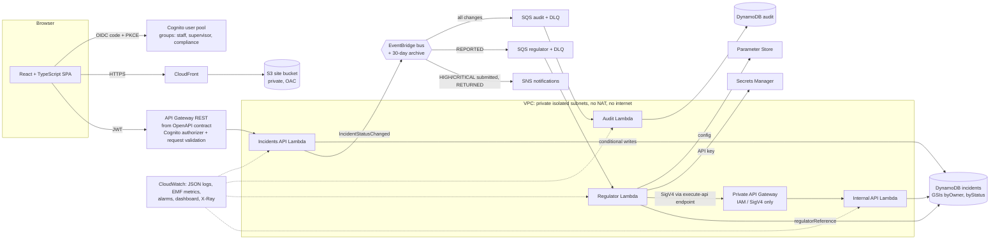

# Care Incident Workflow

A full-stack, serverless incident reporting system for a disability care provider. Staff raise
incidents, supervisors review them, and compliance officers report them to a regulator. Every step
is role-checked, audited and observable.

**Stack:** React + TypeScript (MUI) · Python 3.12 on AWS Lambda · API Gateway (contract-first from
OpenAPI) · Cognito (OIDC, JWT) · DynamoDB · EventBridge · SQS · SNS · Secrets Manager · SSM Parameter
Store · CloudWatch + X-Ray · VPC with private endpoints · private API Gateway with IAM (SigV4) auth ·
AWS CDK (TypeScript) · GitHub Actions.

## Architecture



### Workflow

```
DRAFT ──SUBMIT (owner)──▶ SUBMITTED ──START_REVIEW (supervisor)──▶ UNDER_REVIEW
                              ▲                                     │      │
                              └──SUBMIT (owner)── RETURNED ◀─RETURN─┘      │ APPROVE (supervisor)
                                                  (comment required)       ▼
                         CLOSED ◀──CLOSE (compliance)── REPORTED ◀──REPORT (compliance)── APPROVED
```

The server computes `allowedActions` and `canEdit` for each caller and each incident. The UI renders buttons
from that list and never decides permissions itself. Callers who can't see an incident get `404`, not
`403`, so incident ids can't be probed.

## How this maps to the role requirements

| Requirement | Where it is demonstrated |
| --- | --- |
| React, TypeScript, modern JS | [`frontend/src`](frontend/src): strict TS, hooks, generated API types |
| Component library, responsive design | MUI theme ([`theme.ts`](frontend/src/theme.ts)), light/dark, full-screen dialog on mobile, responsive table columns |
| Complex workflow in role-based UIs | [`App.tsx`](frontend/src/App.tsx), [`IncidentDialog.tsx`](frontend/src/components/IncidentDialog.tsx): role work queues, server-driven actions, return-with-comment, audit history |
| RESTful APIs on AWS | [`api_handler.py`](services/src/incidents/api_handler.py) behind API Gateway |
| OpenAPI / contract-first | [`openapi/incidents-api.yaml`](openapi/incidents-api.yaml) is the source of truth. CDK deploys API Gateway from it ([`openapi.ts`](infra/lib/openapi.ts)), the UI generates types from it, CI lints it |
| Microservices, distributed systems | Separate Lambdas per responsibility, joined by events and queues |
| Synchronous and asynchronous integration | Sync REST and private API. Async EventBridge → SQS → Lambda with partial batch failures, DLQs and idempotent consumers |
| OAuth 2.0, OIDC, JWT | Cognito, Authorization Code + PKCE ([`session.ts`](frontend/src/session.ts)), JWT verified by the API Gateway authorizer, groups claim drives roles |
| Python backend | [`services/src/incidents`](services/src/incidents): no runtime dependencies beyond boto3 |
| Lambda, API Gateway, EventBridge, SQS, SNS, S3, DynamoDB | [`incident-workflow-stack.ts`](infra/lib/incident-workflow-stack.ts) |
| Data design | DynamoDB single table + GSIs per access pattern, optimistic locking (`version` condition), PITR |
| IAM least privilege | Per-function grants, e.g. regulator Lambda gets only `dynamodb:UpdateItem`. Synth-time guardrail rejects `"*"` actions ([`guardrails.ts`](infra/lib/guardrails.ts)) |
| Secrets Manager, Parameter Store | Regulator API key (generated secret) and endpoint config, cached per Lambda environment |
| CloudWatch, observability | Structured JSON logs with correlation ids, EMF custom metrics, X-Ray tracing, API access logs, 7 alarms → SNS, dashboard with a Logs Insights error query |
| VPCs, private APIs, service-to-service security | Isolated subnets, VPC endpoints, flow logs, egress-restricted security group. Private API Gateway with a resource policy limited to one VPC endpoint and one IAM role; SigV4-signed calls |
| Validation, exception handling, audit logging | Validation at API Gateway and in Lambda, typed error responses, immutable audit table fed by events, EventBridge archive for replay |
| CI/CD, testing, security scanning | [`.github/workflows/ci.yml`](.github/workflows/ci.yml): contract lint, ruff, bandit, pytest, npm audit, vitest, CDK assertions, cdk synth, checkov, OIDC-based deploy (no stored AWS keys) |

## Run locally (no AWS account needed)

The UI ships with a demo mode (`public/config.json` → `"mode": "mock"`). It keeps data in the browser
and has a user switcher, so you can walk an incident through every role.

```bash
cd frontend
npm install
npm run gen:api
npm run dev
```

Open http://localhost:5173 and switch between Sam (Staff), Priya (Supervisor) and Chris (Compliance).

## Tests

```bash
cd services && pip install -e ".[dev]" && pytest -q
cd frontend && npm test
cd infra && npm test
```

## Deploy to AWS

Requires AWS credentials and a bootstrapped account (`npx cdk bootstrap`).

```bash
cd frontend && npm run build
cd ../infra && npm install
npx cdk deploy -c azs=1 -c notifyEmail=you@example.com
```

The deployed site loads its API URL and Cognito settings from a `config.json` written by CDK, so one
build works in every environment. Create users and assign groups in Cognito:

```bash
aws cognito-idp admin-create-user --user-pool-id <UserPoolId> --username sam@example.org
aws cognito-idp admin-add-user-to-group --user-pool-id <UserPoolId> --username sam@example.org --group-name staff
```

**Cost:** most resources are pay-per-use and cost cents when idle. The exception is the four VPC
interface endpoints, at about US$0.01 per hour each per AZ. That's roughly US$30 a month with `-c azs=1`.
Run `npx cdk destroy` when you are done.

For CI deploys, create an IAM role that trusts GitHub's OIDC provider. Set its ARN as the repository
variable `AWS_DEPLOY_ROLE_ARN`.

## Design decisions and trade-offs

- **Contract first:** the OpenAPI file has no AWS extensions. CDK adds integrations, the authorizer,
  validators and CORS at synth time, so the contract stays portable and readable.
- **Server-driven permissions:** the workflow rules live in one pure-Python module with table-driven
  tests. The UI's demo mode mirrors them only so it can run offline.
- **Event publishing:** the API writes to DynamoDB, then publishes to EventBridge. A crash between the
  two would lose an event. A production version would use DynamoDB Streams → EventBridge Pipes (an outbox)
  for at-least-once delivery.
- **No internet egress:** Lambdas reach AWS only through VPC endpoints. A real external regulator
  endpoint would need a NAT gateway or an egress proxy. The default `mock` value simulates the submission.
- **Demo-friendly removal policies:** tables and buckets are destroyed with the stack. Switch to
  `RETAIN` and enable deletion protection for real data.
